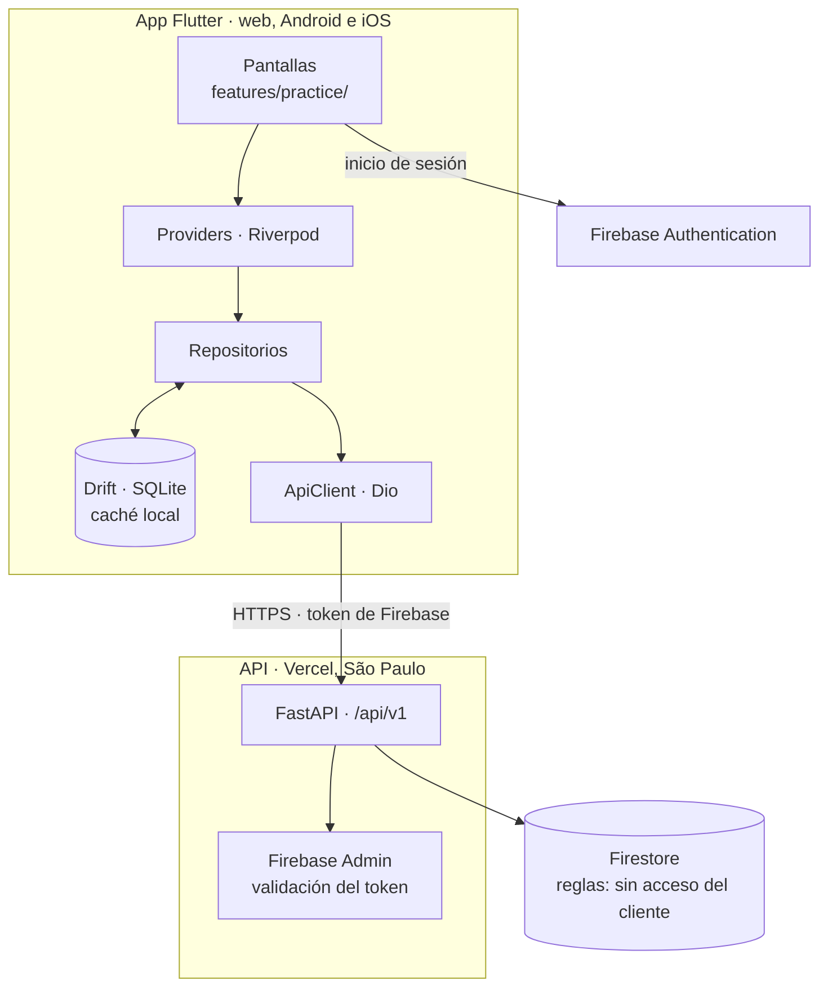

# Módulo de Preguntas · App Aprueba

> Núcleo de práctica de la aplicación de **Aprueba**, plataforma de preparación para la PAES.

Proyecto de Título (Capstone) · Grupo 9 · Duoc UC San Bernardo · 2026


---

## Tabla de contenidos

- [Descripción](#descripción)
- [Estado del proyecto](#estado-del-proyecto)
- [Alcance](#alcance)
- [Tecnologías](#tecnologías)
- [Arquitectura](#arquitectura)
- [Ejecución local](#ejecución-local)
- [Estructura del repositorio](#estructura-del-repositorio)
- [Metodología de trabajo](#metodología-de-trabajo)
- [Convenciones](#convenciones)
- [Uso de inteligencia artificial](#uso-de-inteligencia-artificial)
- [Equipo](#equipo)

---

## Descripción

Aprueba es una plataforma freemium de práctica para estudiantes que rinden la PAES. Entrega un flujo diario de preguntas desde un banco central, con una cuota gratuita que se amplía a cambio de datos del estudiante o con una suscripción de bajo costo.

Este proyecto construye el **módulo de preguntas**, el ciclo en que el estudiante recibe una pregunta, la responde contra reloj, ve su resultado comparado con el de otros estudiantes, revisa la explicación paso a paso y la habilidad evaluada, administra su cuota diaria y puede pedir la revisión de una pregunta que considere errónea.

La empresa contraparte es **Alloxentric**, vinculada mediante la Incubadora Duoc UC San Bernardo.

---

## Estado del proyecto

| | |
|---|---|
| Fase | Fase 2: Desarrollo (semanas 5 a 15) |
| Iteración en curso | Iteración 6 (semana 10): pantalla Habilidad, elegir materia y volver al inicio |
| Avance | 56 de 91 puntos (62 %) al cierre de la iteración 5 |
| Velocidad por iteración | 4, 5, 26, 11 y 10 puntos |
| Entrega funcional 1 | Aceptada en producción el 29/09/2026 |
| Entrega funcional 2 | Cierra con la iteración 6 |

**En producción**

- App web: https://aprueba-app-modulo-preguntas.vercel.app
- API: https://aprueba-app-modulo-preguntas-api.vercel.app/api/v1/health

Cada entrega la acepta el encargado de pruebas del equipo sobre el entorno desplegado, en un navegador real, siguiendo un registro de prueba con pasos y hallazgos.

---

## Alcance

### Pantallas

| Pantalla | Función | Estado |
|---|---|---|
| Pregunta | Enunciado con 4 o 5 alternativas, cronómetro y progreso del día | En producción |
| Resultado | Acierto o error, alternativa correcta, explicación breve, percentil y medalla | En producción |
| Explicación detallada | Pasos, verificación y concepto principal | En producción |
| Habilidad | Habilidad evaluada, dominio, ruta de aprendizaje y recursos | Iteración 6 |
| Recorrección | Solicitud de revisión con motivo y comentario | Iteración 8 |
| Desbloqueo de cuota | Ampliación de la cuota declarando colegio o región | Iteración 7 |

### Servicios

Catorce servicios bajo `/api/v1`: los trece del contrato de la empresa más `GET /me`, que se agregó como ajuste de alcance.

| Grupo | Servicio | Estado |
|---|---|---|
| Perfil | `GET /me` | En producción |
| Configuración | `GET /tests` · `GET /me/preferences` · `PUT /me/preferences` | En producción |
| Práctica | `GET /practice/next` · `GET /questions/{id}` · `POST /questions/{id}/answer` · `GET /questions/{id}/explanation` · `GET /questions/{id}/skill` | En producción |
| Cuota | `GET /me/quota` · `POST /me/quota/unlock` | Iteración 7 |
| Recorrección | `POST /corrections` · `GET /corrections` | Iteración 8 |
| Progreso | `GET /me/progress` | Iteración 9 |

El inicio de sesión con Firebase Authentication entró al alcance por autorización de la empresa. La versión web es plataforma del producto: el mismo código corre en navegador, Android e iOS.

### Fuera del alcance

El registro y el restablecimiento de contraseña, que resuelve Firebase. También el onboarding, la pantalla de inicio, las medallas y canjes, los grupos, la comunidad, los tutores, el muro de pago, los ajustes, las notificaciones, la consola de administración, el generador de preguntas, el sitio web del alumno y la landing.

El banco de preguntas real pertenece a la empresa y no se versiona en este repositorio. El entorno de demostración usa un banco de prueba propio.

---

## Tecnologías

| Capa | Tecnología |
|---|---|
| App | Flutter 3.22+ y Dart 3.3+, con Riverpod, GoRouter, Dio y Drift (SQLite) para la caché local |
| Autenticación | Firebase Authentication con correo y contraseña |
| Backend | Python 3.12 con FastAPI y Pydantic v2 |
| Datos | Firestore, en southamerica-east1 |
| Despliegue | Vercel: un proyecto para la app web y otro para la API, en São Paulo |
| Contenedores | Docker Compose con la API y el emulador de Firestore |
| Pruebas | `pytest` contra el emulador de Firestore y `flutter test` |

Dos decisiones las tomó la empresa durante el desarrollo. El backend pasó de Node con Express a FastAPI, para que fuera consistente con el backend de administración que la empresa ya tiene en ese lenguaje. Y la autenticación pasó de tokens propios a Firebase, que también usa el resto del producto. Las dos llegaron antes de implementar los servicios del módulo, así que solo hubo que rehacer el andamiaje.

---

## Arquitectura



**Flujo.** La interfaz nunca habla directamente con la red: toda petición pasa por `UI → provider → repositorio → ApiClient`. La app tampoco lee Firestore; todo pasa por la API, y las reglas de seguridad niegan cualquier acceso directo del cliente.

**Sesión.** La app inicia sesión con Firebase y envía el token en cada petición. Si la API responde 401, la app pide un token nuevo y reintenta una vez; si vuelve a fallar, cierra la sesión y borra la caché local.

**Respuestas.** Todas comparten la forma `{ data, error, meta }`, con un identificador de solicitud en `meta`. Los errores traen un código estable y un mensaje en español o inglés según el idioma de la app. Los errores de negocio se convierten en estados de pantalla: alcanzar la cuota base lleva a la pantalla de desbloqueo, no a un mensaje de error.

**Integridad.** La alternativa correcta y la explicación no llegan al dispositivo antes de que el estudiante responda. Lo sostienen cinco puntos: la API las elimina antes de responder, ninguna ruta las entrega antes de tiempo, el modelo de la app las acepta vacías, la caché local las guarda solo después de responder y las reglas de Firestore niegan la lectura directa. Una prueba automática recorre todas las rutas y falla si alguna las entrega.

**Pregunta pendiente.** La pregunta entregada queda pendiente hasta que se responde, aunque el estudiante salga y vuelva o abra otra pestaña. Así nadie puede recorrer el banco sin gastar cuota. Responder es una sola transacción que registra la respuesta, descuenta la cuota, otorga las medallas y actualiza las estadísticas de la pregunta.

---

## Ejecución local

**Requisitos:** Flutter 3.22+, Python 3.12 con `uv`, Java 21 para el emulador de Firestore y Node para la CLI de Firebase. Docker Desktop es opcional.

El desarrollo local se hace contra el emulador de Firestore y el backend local, nunca contra producción. El emulador escucha en `127.0.0.1:8085`, el backend en el puerto 4000 y la app web en el 5050, que es el origen que el backend local permite.

```bash
# App
flutter pub get
dart run build_runner build --delete-conflicting-outputs
flutter run -d chrome --web-port=5050 --dart-define=API_BASE_URL=http://localhost:4000/api/v1
```

`build_runner` es obligatorio: genera el código de la caché local, y sin él la app no compila.

La guía completa, con el emulador, la carga de datos de prueba y el backend paso a paso, está en el README del repositorio del proyecto. Con Docker, `docker compose up --build` levanta la API y el emulador juntos.

---

## Estructura del repositorio

```
.
├── lib/                         App Flutter
│   ├── core/                    tema, i18n, router, red y configuración
│   ├── data/                    modelos, repositorios y caché local (Drift)
│   ├── features/practice/       ← módulo de preguntas
│   └── providers/               Riverpod
├── test/                        pruebas de la app
├── backend/
│   ├── app/
│   │   ├── core/                envelope, errores, idioma y autenticación
│   │   ├── routers/             servicios bajo /api/v1
│   │   ├── services/            lógica de negocio
│   │   └── seed/                banco de prueba y datos de demostración
│   └── tests/                   pruebas del backend
├── docs/
│   ├── bitacora_decisiones.md   decisiones de arquitectura y diseño
│   └── diccionario_de_datos.md  colecciones, campos e índices
├── firestore.rules
├── firestore.indexes.json
└── compose.yaml
```

---

## Metodología de trabajo

El proyecto aplica **Extreme Programming** como metodología única. La elección partió de un diagnóstico: el problema del equipo era técnico, porque ninguno había escrito Dart antes de empezar, y XP prescribe las prácticas de ingeniería que ese problema necesita.

### Iteraciones

Diez iteraciones semanales en tres entregas funcionales.

| Iteración | Semana | Contenido | Puntos |
|---|---|---|---|
| 1 | 5 | Despliegue y entorno | 4 |
| 2 | 6 | Modelo de datos | 5 |
| 3 | 7 | Inicio de sesión, configuración y pantalla Pregunta. **Cierra la Entrega 1** | 26 |
| 4 | 8 | Registro de la respuesta, pantalla Resultado y percentil | 11 |
| 5 | 9 | Explicación detallada, facsímil, entorno en los tres equipos y contenedores | 10 |
| 6 | 10 | Habilidad, elegir materia y volver al inicio. **Cierra la Entrega 2** | En curso |
| 7 | 11 | Cuota y desbloqueo | Planificada |
| 8 | 12 | Recorrección | Planificada |
| 9 | 13 | Progreso y práctica sin conexión, en móvil y navegador | Planificada |
| 10 | 14 | Pruebas de integración. **Cierra la Entrega 3** | Planificada |

Al inicio de cada iteración se eligen y estiman las historias del Product Backlog. Al cierre, el encargado de pruebas acepta lo terminado y se registra la velocidad: una historia que no cumple todos los criterios de terminado no suma puntos y pasa a la iteración siguiente.

### Prácticas

Juego de planificación, entregas pequeñas, prueba antes que el código, integración continua mediante solicitudes revisadas, refactorización, diseño simple, propiedad colectiva del código, estándares de código, ritmo sostenible y reflexión de cierre de cada iteración.

### Desviaciones declaradas

**Cliente en sitio.** La empresa no participa del trabajo diario. Las definiciones se consultan por escrito y cada decisión tomada sin confirmación queda registrada en la bitácora con su fuente y su impacto. El encargado de pruebas traduce la especificación de la empresa a pruebas de aceptación, y las entregas se validan con la empresa.

**Reunión de pie.** Se adapta a una sincronización semanal breve, porque los tres integrantes no comparten jornada completa.

---

## Convenciones

### Criterios de terminado

Una historia está terminada cuando cumple todo lo siguiente:

- El encargado de pruebas verificó sus criterios de aceptación sobre el entorno desplegado.
- Las pruebas se escribieron antes del código y pasan, incluida la de integridad.
- El analizador estático no reporta advertencias en el módulo.
- Entró por una solicitud aprobada en GitHub por un integrante distinto del autor.
- Respeta el contrato de la API y traduce los errores de negocio a estados de pantalla.
- No hay secretos ni datos reales en el repositorio, y los datos de producción se cargan desde `main` revisado.
- Sus decisiones quedaron en la bitácora.

### Control de versiones

- Rama principal `main`, protegida por convención: nada entra sin solicitud revisada.
- Ramas de trabajo `feature/*`, `fix/*` y `docs/*`.
- Fusión con commit de fusión, después de la aprobación de otro integrante.
- Cada integrante trabaja con su propia identidad de git.


---

## Equipo

| Integrante | Rol en XP | Responsabilidad principal |
|---|---|---|
| Martin Alonso Espinoza Morales | Tracker y Tester | Seguimiento, velocidad, reflexiones de cierre y pruebas de aceptación |
| Jeremías Danilo Fernández Millacura | Programador | Backend, modelo de datos y despliegue |
| Sebastián Roberto Acevedo Araya | Programador | App y capa de presentación |

La profesora guía, **Eliana Mallen González**, cumple el rol de Coach. Por la empresa, el rol de Cliente lo ejerce la contraparte técnica de Alloxentric y el de Gestora, la jefa de proyecto.

---

## Contexto académico

Proyecto de Título de la asignatura **PTY4614 Capstone**, sección CAPSTONE_002D, de la carrera de Ingeniería en Informática de **Duoc UC, sede San Bernardo**, segundo semestre de 2026.

| Hito | Semana |
|---|---|
| Informe de avance | 9 |
| Presentación de avance | 10 |
| Proyecto completo en contenedores (empresa) | 12 |
| Informe final | 15 |
| Comisión evaluadora | 17 |
| Presentación a empresas vinculadas | 18 |
